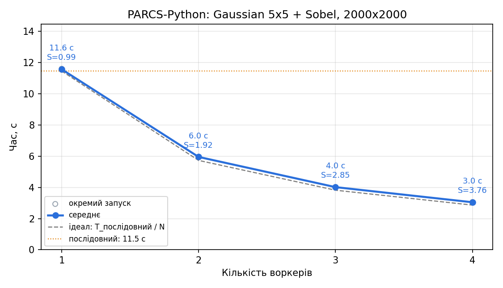

# parcs-sobel

Паралельне виявлення контурів (фільтр Гаусса 5×5 + оператор Собеля 3×3) у системі **PARCS-Python**,
розгорнутій в AWS EC2 (master + 4 воркери).

## Файли

| Файл | Призначення |
|---|---|
| `solver.py` | розв'язок для PARCS (`solve` / `mymap` / `myreduce`), Python 2.7 і 3 |
| `sequential.py` | послідовний алгоритм і перевірка ідентичності результату |
| `local_parcs.py` | локальна перевірка без PARCS (воркери — окремі процеси) |
| `tools/make_input.py` | створення вхідного файлу (PGM) з фото або синтетичного зображення |
| `tools/pgm_to_png.py` | перетворення входу/виходу в PNG |
| `tools/run_benchmark.py` | заміри на кластері через веб-інтерфейс PARCS |
| `tools/plot_results.py` | таблиця і графік часу від кількості воркерів |
| `cloud/aws_setup.sh`, `cloud/aws_teardown.sh` | створення і видалення VM в AWS |
| `inputs/` | вхідні дані |
| `results/` | результати замірів, графіки, скріншоти |

## Запуск

```bash
pip install pillow matplotlib requests

# вхідні дані
python tools/make_input.py --synthetic 2000x2000 inputs/synth_2000.txt

# локально
python local_parcs.py inputs/synth_2000.txt --bench 1 2 3 4
python sequential.py inputs/synth_2000.txt output_seq.txt --check output_local.txt

# AWS (CloudShell)
MY_IP=<public IPv4> bash cloud/aws_setup.sh
python tools/run_benchmark.py http://<MASTER_IP>:8080 inputs/synth_2000.txt
python tools/plot_results.py results/cloud.csv results/cloud_chart.png
bash cloud/aws_teardown.sh
```

Вручну: веб-інтерфейс PARCS → Add Job, Solution File = `solver.py`, Input File = `inputs/*.txt`.
Рядок `# workers 0` у вхідному файлі запускає послідовний варіант на master.

## Результати (AWS, t3.micro, 2000×2000)

| Конфігурація | Час, с | Прискорення | Ефективність |
|---|---:|---:|---:|
| Послідовний | 11.46 | 1.00 | — |
| 1 воркер | 11.57 | 0.99 | 99% |
| 2 воркери | 5.95 | 1.92 | 96% |
| 3 воркери | 4.01 | 2.85 | 95% |
| 4 воркери | 3.05 | 3.76 | 94% |




